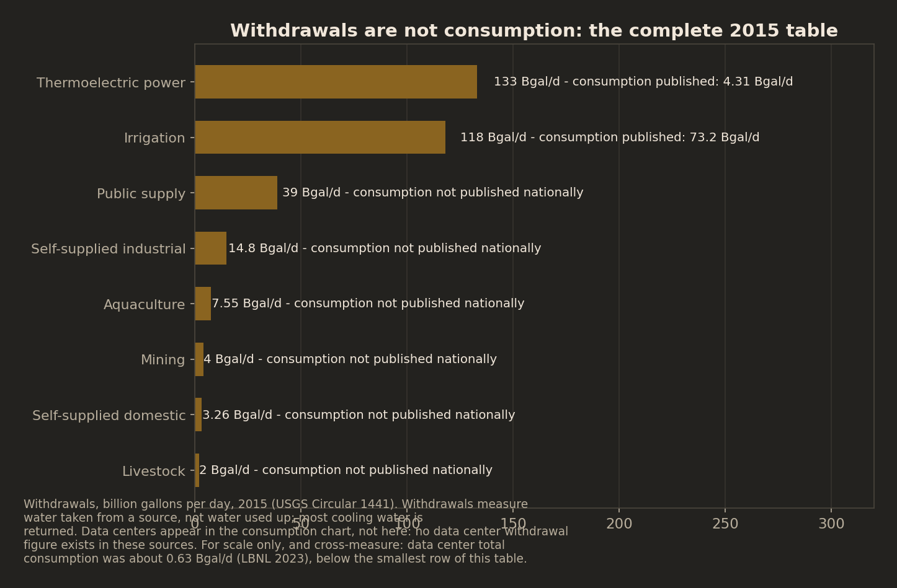
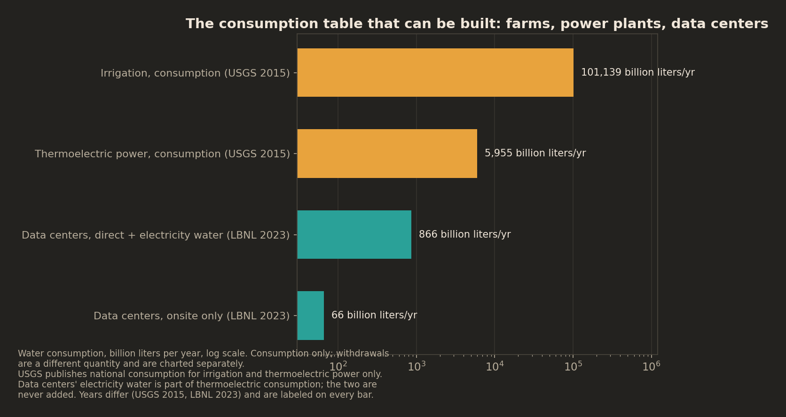
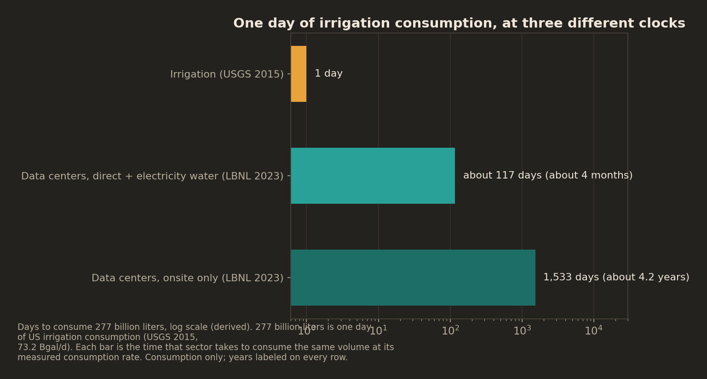

# One Day of Farm Water: Data Centers vs. US Industry, With the Labels On

*A follow-on to yesterday's brief on US data center water: the comparison everyone asks for, built only on figures that measure the same thing, with the years printed. Where the official data cannot support the comparison, the brief says so instead of substituting a different measure and hoping nobody notices.*

## The bottom line

US irrigation consumed about **101 trillion liters of water in 2015** (USGS). All US data centers together, counting both the water used onsite and the water consumed generating their electricity, consumed about **866 billion liters in 2023** (Berkeley Lab). That is **0.86% of irrigation consumption**: irrigation consumes in one day roughly what data centers consume in about 117 days, and consumes onsite data center water at a rate that covers 4.2 years of it per day. Those ratios are the honest headline, and they are smaller than the ones usually quoted, because the usually quoted ones compare water consumed against water merely withdrawn, two different quantities that differ for the largest category by a factor of 31. The other honest headline is that this comparison, the cleanest one available, runs on exactly three consumption series. The federal government publishes national consumption figures for irrigation and power plants and for nothing else, so the all-industry ranking this debate keeps demanding cannot be built from official data. What follows is the closest honest version.

## Finding 1: The obvious chart is dishonest, and one number pair proves it

Ask how much water American industry uses and the first table anyone reaches for is withdrawals: the water each sector takes from rivers, lakes, and aquifers. By withdrawals, thermoelectric power is the largest water user in the country by a wide margin, 133 billion gallons per day in 2015. But the same federal compilation reports that power plants consumed 4.31 billion gallons per day. The rest of the cooling water went back. The same sector, the same year, the same source document: 133 or 4.31, a 31-fold gap, and both numbers are correct. They measure different things.

Data center figures are consumption figures. Berkeley Lab's 66 billion liters of direct water and nearly 800 billion liters of indirect water are water that does not come back. Any chart that places those numbers beside another sector's withdrawals is rigged, in whichever direction the author prefers: it can make data centers look trivial (against 133 billion gallons a day of power plant withdrawals) or make a sector look monstrous (against a data center consumption figure thirty times smaller than the honest comparison). Yesterday's brief refused the unlabeled version of that trick for a single statistic, 0.015% of US withdrawals. This brief refuses it for the whole comparison, which is why the comparison is built the way it is: consumption against consumption, withdrawals in their own separate exhibit, years printed on every figure.

The withdrawals exhibit still earns its place. It is the only complete table USGS publishes, it shows agriculture (irrigation plus livestock, as USGS defines it) taking 120 billion gallons per day, 37.3% of everything withdrawn, and it shows the shape of American water use at the intake pipe. It just cannot answer the question people ask it, which is how much water each sector uses up.

## Finding 2: The consumption table that can actually be built

Three series, and only three, support a national consumption comparison: irrigation and thermoelectric power from USGS's 2015 compilation, and data centers from Berkeley Lab's 2023 estimate. Everything in this section is consumption against consumption.

Irrigation consumed 101,139 billion liters in 2015. Thermoelectric generation consumed 5,955 billion liters. Data centers consumed 866 billion liters in total in 2023, of which 66 billion was direct, onsite water and nearly 800 billion was consumed generating the electricity they bought. Data center direct consumption is therefore about one fifteen-hundredth of irrigation consumption (101,139 / 66 = about 1,530x). Add the electricity water and data centers reach 0.86% of irrigation consumption. Against the power sector's own consumption, data centers' total is about 15%, a figure that needs its framing and gets it in Finding 4.

The equivalences make the scale legible. Irrigation consumes 277 billion liters per day. US data centers consume 66 billion liters onsite in a year, so one day of irrigation consumption equals about 4.2 years of data center onsite consumption. Count the electricity water too and the pace changes but the shape does not: data centers consume 2.37 billion liters per day in total, so one day of irrigation consumption equals about 117 days, roughly four months, of all US data center consumption, direct and indirect combined.

Read the balance at the same size, because both halves are true. At national scale, on the only basis that counts, data centers are a small water consumer next to agriculture: under 1% of what irrigation consumes, even with the electricity water included and even using the widest boundary anyone credible publishes. And, per Finding 5, data centers are also the only consumer in the table whose use roughly tripled inside a decade. Small and fast-growing is the whole finding; quoting only the first half or only the second is how this statistic gets abused in both directions.

## Finding 3: Agriculture in full, because that is the comparison people mean

When someone asks how data centers stack up against "other industries," the comparison they usually mean is farms. USGS splits agriculture into irrigation and livestock, and the split itself is a trap worth naming. Livestock withdrawals are 2.00 billion gallons per day, small enough that a lazy version of this brief could announce that data centers rival livestock. That line would be false in substance: most of livestock's water footprint is the irrigated feed crops animals eat, and USGS counts that water under irrigation, not livestock. So this brief defines agriculture up front as USGS does, irrigation plus livestock together: 120 billion gallons per day withdrawn in 2015, 37.3% of all US withdrawals, 165,801 billion liters per year.

Inside that total, irrigation does nearly all the consuming. Irrigation consumption of 73.2 billion gallons per day is 62% of irrigation's total use, and it is the largest consumptive use USGS measures, about 17 times thermoelectric consumption. Irrigation was also the one major category whose withdrawals rose between 2010 and 2015, up 2%, while total US withdrawals fell to their lowest since before 1970.

Two caveats belong here rather than in a footnote. First, irrigation consumption is geographically concentrated and groundwater-heavy in a way national totals flatten: its weight in the specific basins where water is scarce, several of which also attract data center construction, is larger than any national share suggests. This brief is national by design, and the basin question is a different brief that national data cannot answer. Second, nothing in the comparison is an argument that either use is wasteful. Irrigation grows food; the point of putting the two consumption figures on one labeled chart is that the public argument currently runs on numbers that do not measure the same thing.

## Finding 4: The overlap, disclosed instead of hidden

Data centers' indirect water, nearly 800 billion liters in 2023, is not extra water on top of the power sector's total. It is a slice of it: the water consumed generating electricity, which is exactly what USGS counts as thermoelectric consumptive use (5,955 billion liters in 2015). Two rules follow, and this brief obeys both everywhere, graphics included. The figures are never added together. And the ratio between them is printed as what it is, a part compared to the whole that contains it: data centers' electricity water equals about 13% of all the water the power sector consumed in 2015, and data center total consumption equals about 15% of it, across a year gap (2023 against 2015) that is printed every time.

Stated that way, the figure is informative rather than rigged. Roughly one-seventh of the water consumed making America's electricity is attributable to electricity that data centers consume. That is the sense in which data centers are a material water user even at under 1% of irrigation: inside the one system they actually draw on, electricity, their share is large enough to matter to grid planning, and it is growing with their load. It is not a ranking against other sectors, and anyone quoting it as one has dropped the framing this brief attaches to it.

## Finding 5: The growth asymmetry is the honest tension

Every figure above is a level. The levels favor calm; the trends are the reason the argument exists. Data center direct consumption roughly tripled in nine years, from 21.2 billion liters in 2014 to 66 billion in 2023 (Berkeley Lab), and the load growth behind the indirect figure is faster still: yesterday's brief documented US data center electricity rising from 176 TWh in 2023 toward a 2030 reference case of 649 TWh. Over the periods USGS measures, the established categories moved the other way or held still. Total withdrawals fell 9% from 2010 to 2015, thermoelectric withdrawals fell 18%, self-supplied industrial withdrawals have fallen from a 1970 peak of 47 billion gallons per day to 14.8, and irrigation consumption in USGS's modeled 2010 to 2020 averages (75,698 million gallons per day, conterminous US, a different basis from the 2015 compilation and used here as corroboration only) sits close to its 2015 value of 73.2 billion gallons per day.

Those two series, a federal lab's data center model and the USGS compilations, are stated on their own terms because they are different instruments. But the tension they create is real and is the correct reason to keep measuring: a consumer at 0.86% of irrigation consumption that doubles on a short cycle does not stay at 0.86%, and a comparison built in 2026 will be stale in a way a comparison of mature categories would not. The level says data centers are small. The trend says the level has a short shelf life. Both belong in the headline, and this brief puts them there.

## Finding 6: The ranking nobody can build

The deepest finding in this brief is an absence. There is no official national consumptive-use figure for US industry, for cities, or for livestock, for 2015 or for any recent year. USGS published national consumption estimates in 1995, stopped, and restored them in the 2015 compilation for two categories only. The Circular series then ended: there is no 2020 Circular, and the post-2015 modeled estimates that do exist cover three categories for the conterminous US as decade averages, with the other five categories scattered across separate data releases. The comparison the entire public argument wants, every sector's true consumption on one chart, cannot be assembled from official data by anyone, at any level of effort. It is not that the data is hard to find. It does not exist.

Yesterday's brief made the same point about data centers specifically: the US has no reporting mandate, so the national picture is one lab's model plus whatever companies volunteer. The gap is wider than data centers. A country that cannot say how much water its factories or its cities consume is arguing about all of these sectors in the dark, and filling the dark with withdrawal numbers that measure something else. What would settle the argument is unglamorous: routine, mandated, category-wide consumption reporting of the kind the EU already requires of data centers, plus a data center water assessment newer than December 2024. Until then, the honest chart has three bars and a labeled list of the bars that cannot be drawn.

## What this does not prove

Nothing here measures local impact. Water stress is watershed-specific and seasonal; irrigation's national dominance says nothing about whether a specific data center in a specific basin is a problem, and data centers' small national share says nothing exculpatory about any specific facility either. The comparison crosses years by necessity (USGS 2015, the last compilation with a national consumption split, against Berkeley Lab 2023), and every cross-year figure carries both years; categories that moved fast between 2015 and 2023 would narrow or widen these ratios, and the one that moved fastest is data centers. USGS thermoelectric withdrawals include saline cooling water while irrigation is all freshwater; this brief uses the as-published totals and runs no freshwater-only cut. Berkeley Lab's figures are modeled estimates, not meter readings. And consumption is not the only thing that matters about water: withdrawal timing, return flows, and water quality all shape real impacts and none of them fit in this comparison.

## Methods

Scope is national aggregates for the United States. Primary sources only: USGS Circular 1441 (2015), USGS Professional Paper 1894 Chapter D (corroboration footnote only, never mixed into Circular 1441 figures), and Berkeley Lab's December 2024 data center report for the data center series. Withdrawal and consumption are never combined in a single figure; every comparison states which measure each side uses. Data centers' indirect water is never added to thermoelectric consumption, because it is contained in it, and the part-vs-whole nature of their ratio is printed wherever the ratio appears. Conversions use 1 US gallon = 3.78541 liters; billion gallons per day to billion liters per year multiplies by 1,381.67. Agriculture is defined as irrigation plus livestock, following USGS, because livestock's feed-crop water sits inside irrigation. Every figure was transcribed from the source document or the verified data spine of the predecessor package; values, units as printed, and conversion factors are in `data/sources.md`, and headline figures with source keys are in `data/stats.json`. Where a comparison could not be verified to a primary source, it was dropped; the dropped list, with reasons, is at the end of `data/sources.md`.

## Data sources

- US Geological Survey, "Estimated Use of Water in the United States in 2015", Circular 1441 (Dieter et al.), June 2018
- US Geological Survey, "Water use across the conterminous United States, water years 2010-20", Professional Paper 1894, Chapter D (Medalie et al.)
- Lawrence Berkeley National Laboratory, "2024 United States Data Center Energy Usage Report", December 2024 (LBNL-2001637)
- Predecessor brief: "Known vs. Asserted: US Data Center Water", Machine Readable, October 12, 2026

## Reproduce

1. Read `data/sources.md` for the document, unit, and conversion behind every figure
2. Run `python code/charts.py` to regenerate all charts into `charts/`
3. Check any figure against `data/stats.json`, which carries the same values keyed to their sources

Requires Python 3 with matplotlib and numpy.
